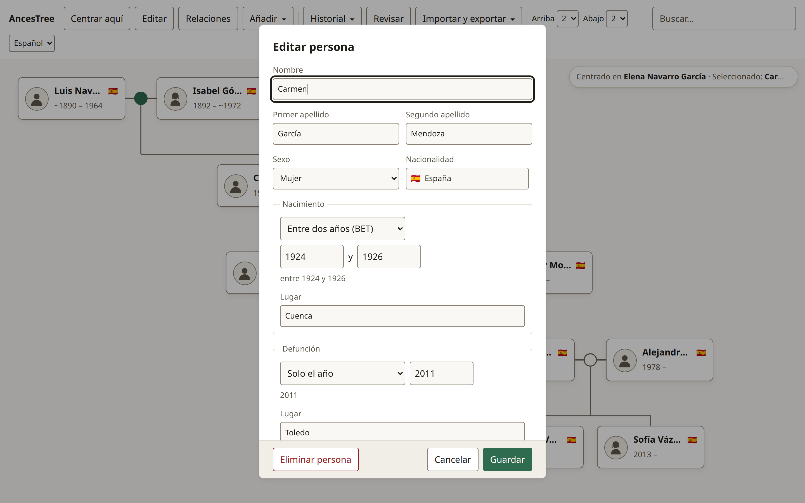
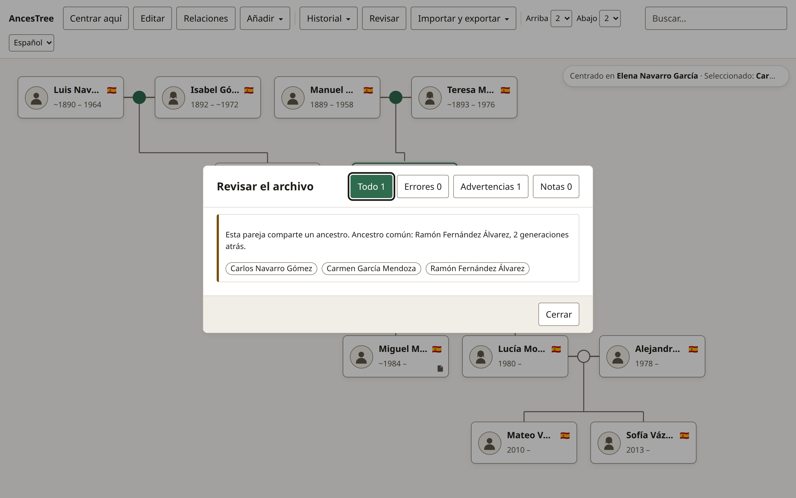

<div align="center">


# AncesTree

**Un árbol y archivo genealógico _local-first_ que vive en tu propio dispositivo.**  
Sin cuentas · Sin nube · Sin suscripciones · Cero dependencias de runtime

[**Demo en Vivo ↗**](https://miguelrm90.github.io/ances-tree/) · [**Documentación de Diseño**](docs/README.md) · [**English**](README.md) · **Español**

[](package.json)
[](test/)
[](docs/architecture.md)
[](docs/storage.md)
[](public/manifest.webmanifest)
[](LICENSE)

</div>

---

<div align="center">
  <picture>
    <source media="(prefers-color-scheme: dark)" srcset="docs/assets/hero-tree-dark.es.png" />
    <source media="(prefers-color-scheme: light)" srcset="docs/assets/hero-tree-light.es.png" />
    
  </picture>
  <p><em>5 generaciones renderizadas en una sola vista con doble apellido español, fechas históricas difusas, filiación adoptiva y detección automática de consanguinidad. <strong>Pulsa «Probar con una familia de ejemplo» en la pantalla de bienvenida para explorarlo en 1 clic.</strong></em></p>
</div>

|                                      Editor de Persona y Fechas Históricas Difusas                                      |                                        Revisión del Archivo y Detección de Consanguinidad                                         |
| :---------------------------------------------------------------------------------------------------------------------: | :-------------------------------------------------------------------------------------------------------------------------------: |
|  |  |

---

## ¿Por qué AncesTree?

Construye y conserva el archivo genealógico de tu familia directamente en el navegador. **Los datos nunca salen de tu equipo.** Cuando quieras compartirlos con un familiar, le entregas una carpeta normal o un archivo ZIP estándar.

| Característica                | Plataformas SaaS en la Nube       | Software Clásico de Escritorio       | **AncesTree**                                                                       |
| :---------------------------- | :-------------------------------- | :----------------------------------- | :---------------------------------------------------------------------------------- |
| **Propiedad y Privacidad**    | Subido a servidores de terceros   | Local, a menudo en formatos cerrados | **100% Local-First** (`family.json` + `family.ged` + carpetas multimedia)           |
| **Coste / Dependencia**       | Suscripciones mensuales y límites | Licencias por sistema operativo      | **Libre y gratuito (MIT)**, sin bloqueo de proveedor                                |
| **Fotos y Documentos**        | Limitados por cuota en la nube    | Disco local                          | **Sin límite práctico en escritorio** (`File System Access API`)                    |
| **Móvil y Multiplataforma**   | Requiere cuenta y conexión        | Solo escritorio                      | **PWA instalable 100% offline** (`DISK` en PC, `OPFS` en móvil)                     |
| **Sistema de Doble Apellido** | Un único campo rompe las líneas   | Soporte parcial o forzado            | **Primer y segundo apellido nativos** (`lastName` + `secondLastName`)               |
| **Incertidumbre en Fechas**   | Fuerza fechas exactas irreales    | Variable                             | **Álgebra de intervalos** (`ABT`, `EST`, `BEF`, `AFT`, `BET…AND`) conservando `raw` |
| **Dependencias de Runtime**   | Megabytes de librerías externas   | Instaladores pesados                 | **0 dependencias en producción** (~60 KB comprimido en total)                       |

---

## Engineering Highlights (Aspectos Destacados de Ingeniería)

AncesTree ha sido diseñado desde cero como demostración técnica de las capacidades nativas de la plataforma web moderna, sin frameworks ni librerías de terceros en tiempo de ejecución:

### 1. Cero Dependencias en Producción (`"dependencies": {}`)

Todos los subsistemas están construidos exclusivamente sobre APIs estándar del navegador (`HTMLElement`, Shadow DOM, `adoptedStyleSheets`, `CompressionStream`, `DecompressionStream`, `FileSystemDirectoryHandle`, `IndexedDB`, `SubtleCrypto`, `OffscreenCanvas`). El bundle completo de producción ocupa **~60 KB gzipped** y elimina cualquier riesgo de cadena de suministro (_supply-chain_).

### 2. Motor ZIP en Streaming Propio ([`src/storage/zip/`](src/storage/zip))

En lugar de depender de librerías como `JSZip` ni cargar archivos enteros en memoria RAM, AncesTree implementa la especificación binaria PKWARE ZIP desde cero:

- **Compresión y Extracción por Streams**: Canaliza fragmentos binarios mediante `CompressionStream('deflate-raw')` y `DecompressionStream('deflate-raw')` directamente hacia los descriptores de disco.
- **Verificación Incremental CRC-32**: Calcula y verifica sumas de comprobación bloque a bloque ([`crc32.js`](src/storage/zip/crc32.js)) aplicando presupuestos estrictos contra bombas ZIP antes de descomprimir.

### 3. Motor GEDCOM 5.5.1 Bidireccional Propio ([`src/domain/gedcom/`](src/domain/gedcom))

Parser, importador y exportador sin dependencias preparado para archivos genealógicos reales:

- **Decodificador Multiformato**: Detecta y decodifica automáticamente `UTF-8`, `UTF-16LE` / `UTF-16BE` (mediante BOM), `ISO-8859-1` y codificación histórica `ANSEL` ([`parser.js`](src/domain/gedcom/parser.js)).
- **Fidelidad de Doble Apellido Español**: Conserva el apellido paterno y materno entre etiquetas `NPFX`/`SURN`/`_SURN2` y nombres delimitados por barras ([`gedcom-mapping.md`](docs/gedcom-mapping.md)).
- **Protección contra Inyección**: Sanea saltos de línea y escapa punteros `@` al exportar, verificado con ciclos completos sobre archivos de **10.000 personas**.

### 4. Motor Matemático de Layout de Grafos 2D ([`src/domain/layout/`](src/domain/layout))

El motor de maquetación ([`engine.js`](src/domain/layout/engine.js)) es **100% matemático y puro**: jamás invoca `getBoundingClientRect()` ni mide el DOM:

- **Ventana de Pedigrí Acotada**: Acota tanto la profundidad generacional como la anchura lateral alrededor de la persona focal ([`generations.js`](src/domain/graph/generations.js)), maquetando archivos de 10.000 personas en **< 5 ms**.
- **Enrutamiento Ortogonal SVG y Múltiples Uniones**: Sitúa segundas nupcias de forma simétrica (`[Pareja 1] · [Persona] · [Pareja 2]`) y calcula conectores SVG ([`edges.js`](src/domain/layout/edges.js)) distinguiendo líneas continuas (filiación biológica) y discontinuas (adopción/acogida).

### 5. Arquitectura Dual de Almacenamiento Local-First ([`src/storage/`](src/storage))

Persistencia elegida por detección de capacidades ([`backend.js`](src/storage/backend.js)), nunca por _user-agent_:

- **Modo `DISK` (Escritorio Chromium)**: Lee y escribe directamente en una carpeta real elegida por el usuario en su disco duro mediante **File System Access API**, guardando el `FileSystemDirectoryHandle` en IndexedDB para reabrir en un clic.
- **Modo `BROWSER` (Firefox, Safari, iOS/Android)**: Opera de forma idéntica sobre el **Origin Private File System (OPFS)** (`navigator.storage.getDirectory()`), con rotación automática de copias de seguridad (`backups/family-YYYY-MM-DDTHHmmss.json`) y exportación ZIP en streaming.
- **Privacidad en Fotografías**: Recodifica las imágenes al importarlas mediante `OffscreenCanvas` ([`media.js`](src/storage/media.js)) para eliminar metadatos EXIF/GPS conservando la transparencia alfa en PNG/WebP y deduplicando por hash SHA-256 (`photos/<ab>/<sha256>.ext`).

### 6. Fechas Históricas Difusas y Validación No Bloqueante ([`src/domain/date/`](src/domain/date), [`src/domain/validation/`](src/domain/validation))

- **Contrato Inmutable `raw`**: La genealogía real rara vez tiene fechas exactas. Expresiones como `ABT 1885` (_hacia 1885_), `BEF MAY 1912` (_antes de mayo de 1912_) o `BET 1900 AND 1905` (_entre 1900 y 1905_) se traducen a intervalos de Día Juliano `[earliest, latest]` para comparar cronologías sin sobrescribir jamás el texto original.
- **Filosofía `WARNING` frente a `ERROR`**: Solo se bloquean (`ERROR`) mutaciones estructuralmente imposibles en el grafo (ciclos de ascendencia, ser progenitor de uno mismo, más de 2 progenitores biológicos, referencias rotas). Las anomalías históricas —como matrimonios entre primos con cálculo automático del ancestro común, edades inusuales o fechas imprecisas— se muestran como advertencias (`WARNING`) navegables en el panel de Revisión ([`validation-rules.md`](docs/validation-rules.md)).

### 7. Arquitectura Estricta, CSP y 334 Tests en Navegador Real ([`test/`](test))

- **Capas Unidireccionales Cumplidas por Linter**: `UI → Store → Domain → Storage`, impuestas mediante [`eslint.config.js`](eslint.config.js) (`no-restricted-imports`). `domain/` no importa nada del DOM ni de almacenamiento.
- **CSP Estricta en Producción**: Sin estilos inline (`adoptedStyleSheets` exclusivamente), prohibición total de `innerHTML` con datos de usuario y cero peticiones de red externas ([`decisions.md`](docs/decisions.md)).
- **334 Tests en Chromium Real**: Ejecutados con `@web/test-runner`, cubriendo OPFS real, streaming ZIP, casos límite de GEDCOM, geometría SVG, navegación por teclado (`roving tabindex`) y verificación automatizada de **contraste WCAG AA** en modo claro y oscuro ([`contrast.test.js`](test/contrast.test.js)).

---

## Estructura del Archivo Familiar en Disco

Tanto si se guarda en una carpeta de tu ordenador como si se exporta en un `.zip` desde el móvil, todo archivo de AncesTree mantiene exactamente la misma estructura abierta y legible:

```text
Familia-Navarro-Garcia/
├─ family.json     # Grafo canónico (personas, uniones, filiaciones, medios, ajustes)
├─ family.ged      # Proyección GEDCOM 5.5.1 estándar para otro software de genealogía
├─ manifest.json   # Metadatos del archivo y recuento de entidades
├─ photos/         # Retratos y fotografías direccionados por hash (photos/<ab>/<sha256>.ext)
├─ documents/      # Partidas, certificados y documentos adjuntos (PDF, TXT, etc.)
└─ backups/        # Copias rotativas automáticas previas a cada guardado
```

---

## Arquitectura en Capas

```text
┌───────────────────────────────────────────────────────────────────┐
│  Capa UI (src/ui/)                                                │
│  Web Components nativos, Shadow DOM, Constructable Stylesheets    │
└─────────────────────────────────┬─────────────────────────────────┘
                                  │ CustomEvents ↑ / Propiedades ↓
                                  ▼
┌───────────────────────────────────────────────────────────────────┐
│  Capa Store (src/store/)                                          │
│  Singleton reactivo (EventTarget), pila Undo/Redo, historial foco │
└───────────────┬───────────────────────────────────┬───────────────┘
                │ Datos puros                       │ Objetos planos
                ▼                                   ▼
┌───────────────────────────────┐   ┌───────────────────────────────┐
│  Capa Domain (src/domain/)    │   │  Capa Storage (src/storage/)  │
│  Funciones 100% puras:        │   │  DISK (File System Access) y  │
│  Modelo, Fechas, Grafo,       │   │  BROWSER (OPFS), Streaming    │
│  Layout, Validación, GEDCOM   │   │  ZIP, Medios SHA-256, IDB     │
└───────────────────────────────┘   └───────────────────────────────┘
```

La documentación técnica completa se encuentra en [`docs/`](docs/README.md):

- [**Visión y Principios**](docs/vision.md) — Modelo de privacidad, alcance y filosofía _local-first_.
- [**Arquitectura y Motor de Layout**](docs/architecture.md) — Contratos entre capas y algoritmo de coordenadas en 4 fases.
- [**Contrato del Modelo de Datos**](docs/data-model.md) — Entidades, intervalos de fechas difusas y aristas por progenitor.
- [**Almacenamiento y Formato ZIP**](docs/storage.md) — Modos `DISK` vs `BROWSER` (OPFS), streaming ZIP y copias de seguridad.
- [**Catálogo de Reglas de Validación**](docs/validation-rules.md) — Tabla completa de reglas `ERROR`, `WARNING` e `INFO`.
- [**Mapeo GEDCOM 5.5.1 / 7.0**](docs/gedcom-mapping.md) — Conversión bidireccional y soporte de codificaciones.
- [**Decisiones Técnicas y CSP**](docs/decisions.md) — Por qué Web Components puros, cero dependencias y CSP estricta.

---

## Ejecución en Local

```bash
# Instalar herramientas de desarrollo (Vite, Web Test Runner, ESLint)
pnpm install

# Iniciar servidor de desarrollo en http://localhost:5173/
pnpm dev

# Ejecutar los 334 tests en un navegador Chromium real
# (En Linux, define CHROME_PATH=/usr/bin/google-chrome si no se detecta automáticamente)
CHROME_PATH=/usr/bin/google-chrome pnpm test

# Ejecutar linter (reglas de capas y estilo)
pnpm run lint

# Generar build de producción en dist/
pnpm run build
```

### Pruebas de Estrés a Gran Escala (10.000 Personas)

AncesTree incluye un generador determinista con semilla y un banco de pruebas para verificar los tiempos de maquetación, validación e importación/exportación GEDCOM frente a un archivo realista de 10.000 personas y 10 generaciones:

```bash
pnpm run stress:generate   # Genera ./stress-10k (10.000 personas, fechas difusas, adopciones, matrimonios entre primos)
pnpm run stress:bench      # Mide los tiempos frente al presupuesto de rendimiento
```

---

## Licencia

Distribuido bajo la [Licencia MIT](LICENSE).
