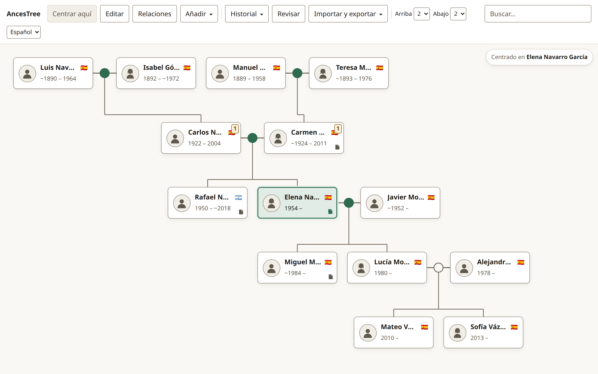
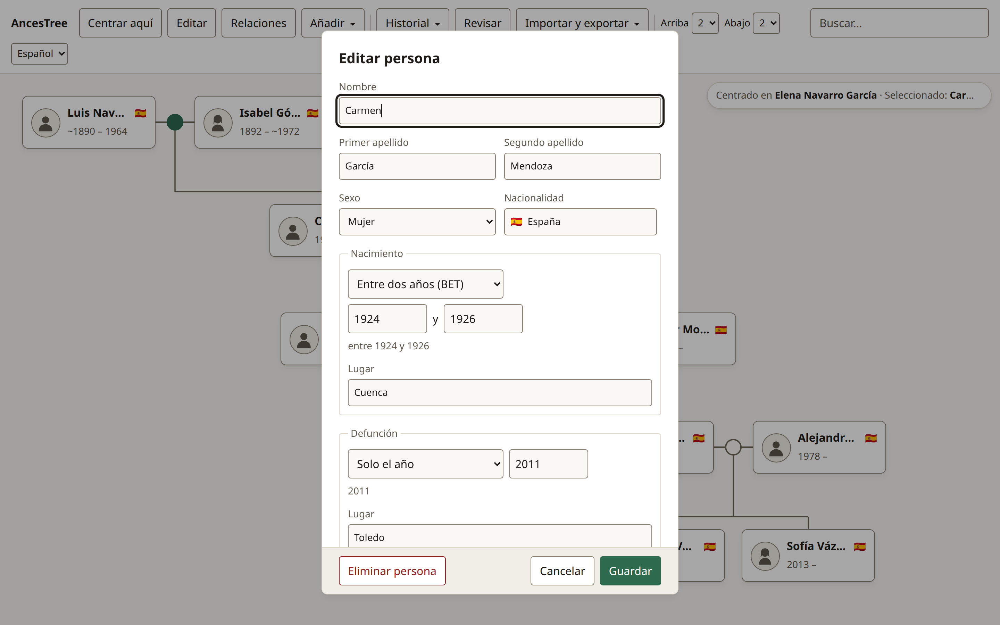
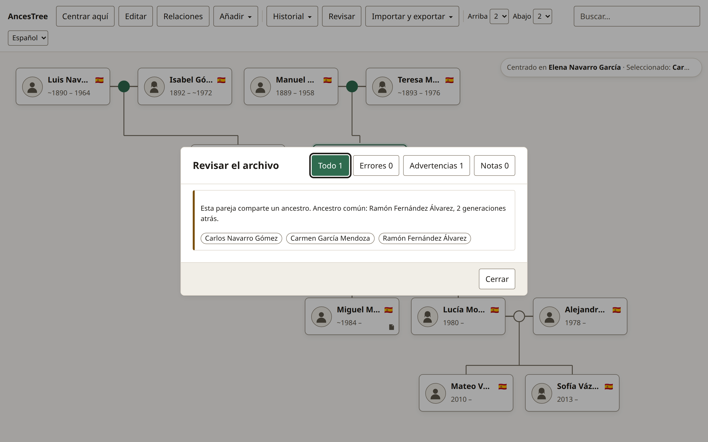

<div align="center">


# AncesTree

**A local-first family tree and genealogical archive that lives on your own device.**  
No accounts · No cloud · No subscriptions · Zero runtime dependencies

[**Live Demo ↗**](https://miguelrm90.github.io/ances-tree/) · [**Design Docs**](docs/README.md) · **English** · [**Español**](README.es.md)

[](package.json)
[-2e6f40?style=flat-square>)](test/)
[](docs/architecture.md)
[](docs/storage.md)
[](public/manifest.webmanifest)
[](LICENSE)

</div>

---

<div align="center">
  <picture>
    <source media="(prefers-color-scheme: dark)" srcset="docs/assets/hero-tree-dark.png" />
    <source media="(prefers-color-scheme: light)" srcset="docs/assets/hero-tree-light.png" />
    
  </picture>
  <p><em>5 generations rendered in a single view with Spanish dual surnames, uncertain historical dates, adoptive lineage, and automatic consanguinity detection. <strong>Click "Try with a sample family" on the welcome screen to explore it in 1 click.</strong></em></p>
</div>

|                                      Person Editor & Fuzzy Historical Dates                                      |                                       Archive Review & Consanguinity Detection                                       |
| :--------------------------------------------------------------------------------------------------------------: | :------------------------------------------------------------------------------------------------------------------: |
|  |  |

---

## Why AncesTree?

Build and preserve your family's genealogical archive directly in the browser. **Your data never leaves your machine.** When you want to share it with a relative, you hand them a plain folder or a standard ZIP archive.

| Capability                      | Cloud Genealogy SaaS                 | Legacy Desktop Apps               | **AncesTree**                                                                 |
| :------------------------------ | :----------------------------------- | :-------------------------------- | :---------------------------------------------------------------------------- |
| **Data Ownership & Privacy**    | Uploaded to proprietary servers      | Local, often proprietary DB files | **100% Local-First** (`family.json` + `family.ged` + media folders)           |
| **Recurring Cost / Lock-in**    | Monthly paywalls & tree size limits  | Paid OS-specific licenses         | **Free & Open Source (MIT)**, zero vendor lock-in                             |
| **Media & Document Storage**    | Cloud quota limits                   | Local disk                        | **Unlimited on desktop disk** (`File System Access API`)                      |
| **Cross-Device & Mobile**       | Requires account login               | Desktop-only                      | **Installable Offline PWA** (`DISK` on desktop, `OPFS` on mobile)             |
| **Spanish Naming System**       | Single surname field breaks lineages | Partial / awkward                 | **First-class dual surnames** (`lastName` + `secondLastName`)                 |
| **Historical Date Uncertainty** | Often coerces into exact dates       | Varies                            | **Interval algebra** (`ABT`, `EST`, `BEF`, `AFT`, `BET…AND`) preserving `raw` |
| **Runtime Dependencies**        | Megabytes of third-party bundles     | Heavy native installers           | **0 runtime dependencies** (~60 KB gzipped total)                             |

---

## Engineering Highlights

AncesTree was engineered from first principles as a showcase of modern web platform capabilities without external frameworks or runtime libraries:

### 1. Zero Runtime Dependencies (`"dependencies": {}`)

Every subsystem is built exclusively on native Web APIs (`HTMLElement`, Shadow DOM, `adoptedStyleSheets`, `CompressionStream`, `DecompressionStream`, `FileSystemDirectoryHandle`, `IndexedDB`, `SubtleCrypto`, `OffscreenCanvas`). Production bundle size is **~60 KB gzipped** with zero supply-chain risk.

### 2. Custom Streaming ZIP Engine ([`src/storage/zip/`](src/storage/zip))

Rather than pulling in `JSZip` and buffering entire archives in RAM, AncesTree implements the PKWARE ZIP format specification from scratch:

- **Streaming Deflate & Extract**: Pipes file chunks through `CompressionStream('deflate-raw')` and `DecompressionStream('deflate-raw')` directly to disk handles.
- **Incremental CRC-32 Verification**: Computes and verifies checksums chunk-by-chunk ([`crc32.js`](src/storage/zip/crc32.js)) while enforcing zip-bomb size budgets before extraction.

### 3. Bidirectional GEDCOM 5.5.1 Engine ([`src/domain/gedcom/`](src/domain/gedcom))

A zero-dependency parser, importer, and exporter supporting real-world genealogical archives:

- **Multi-Encoding Decoder**: Automatically detects and decodes `UTF-8`, `UTF-16LE` / `UTF-16BE` (with BOM), `ISO-8859-1`, and legacy `ANSEL` ([`parser.js`](src/domain/gedcom/parser.js)).
- **Spanish Dual-Surname Round-Tripping**: Preserves paternal and maternal surnames across `NPFX`/`SURN`/`_SURN2` and slash-delimited `NAME` tags ([`gedcom-mapping.md`](docs/gedcom-mapping.md)).
- **Injection Hardening**: Sanitizes embedded newlines and escapes `@` pointers on export, verified across **10,000-person** synthetic archives.

### 4. Mathematical 2D Graph Layout Engine ([`src/domain/layout/`](src/domain/layout))

The layout engine ([`engine.js`](src/domain/layout/engine.js)) is **100% mathematical and pure**—it never calls `getBoundingClientRect()` or queries the DOM:

- **Pedigree Windowing**: Bounds both generational depth and lateral breadth around the focal person ([`generations.js`](src/domain/graph/generations.js)) so a 10,000-person archive lays out in **< 5 ms**.
- **Multi-Partner & Adoptive Routing**: Places remarriages symmetrically (`[Partner 1] · [Person] · [Partner 2]`) and computes orthogonal SVG bus connectors ([`edges.js`](src/domain/layout/edges.js)) with distinct solid (biological) and dashed (adoptive/foster) strokes.

### 5. Dual Local-First Storage Architecture ([`src/storage/`](src/storage))

Capability-detected persistence ([`backend.js`](src/storage/backend.js)) with zero user-agent sniffing:

- **`DISK` Mode (Chromium Desktop)**: Reads and writes directly to a user-chosen folder on the operating system via the **File System Access API**, storing `FileSystemDirectoryHandle` references in IndexedDB for permissioned reopening.
- **`BROWSER` Mode (Firefox, Safari, iOS/Android)**: Operates identically against the **Origin Private File System (OPFS)** (`navigator.storage.getDirectory()`), with automatic rotating backups (`backups/family-YYYY-MM-DDTHHmmss.json`) and streaming ZIP export.
- **Privacy on Photo Import**: Re-encodes imported images through `OffscreenCanvas` ([`media.js`](src/storage/media.js)) to strip GPS/EXIF metadata while preserving PNG/WebP alpha transparency and deduplicating files by SHA-256 content hash (`photos/<ab>/<sha256>.ext`).

### 6. Uncertain Historical Dates & Non-Blocking Validation ([`src/domain/date/`](src/domain/date), [`src/domain/validation/`](src/domain/validation))

- **Immutable `raw` Date Contract**: Historical records rarely have exact ISO dates. Strings like `ABT 1885`, `BEF MAY 1912`, or `BET 1900 AND 1905` are parsed into Julian Day Number intervals `[earliest, latest]` for chronological comparison while never overwriting the user's original string.
- **`WARNING` vs `ERROR` Philosophy**: Only structurally impossible graph mutations (cycles in lineage, self-parenthood, >2 biological parents, dangling references) are blocked (`ERROR`). Historical anomalies—such as consanguineous marriages (cousins sharing a common ancestor), unusual parental ages, or imprecise dates—are surfaced as navigable `WARNING` notes in the Review panel ([`validation-rules.md`](docs/validation-rules.md)).

### 7. Strict Architecture, CSP & Real-Browser Test Suite ([`test/`](test))

- **Enforced Unidirectional Layers**: `UI → Store → Domain → Storage`, enforced by [`eslint.config.js`](eslint.config.js) (`no-restricted-imports`). `domain/` imports zero DOM or storage APIs.
- **Strict Production CSP**: No inline styles (`adoptedStyleSheets` only), no `innerHTML` with user data, and zero external network requests ([`decisions.md`](docs/decisions.md)).
- **334 Real-Browser Tests**: Executed in headless Chromium via `@web/test-runner`, covering OPFS file streaming, ZIP round-tripping, GEDCOM edge cases, SVG edge geometry, keyboard roving `tabindex`, and automated **WCAG AA contrast ratio** verification across light and dark themes ([`contrast.test.js`](test/contrast.test.js)).

---

## Archive Structure on Disk

Whether stored in a folder on your desktop or exported as a `.zip` from your phone, every AncesTree archive has the exact same open, human-readable layout:

```text
Navarro-Garcia-Family/
├─ family.json     # Canonical graph (persons, unions, parentChildren, media, settings)
├─ family.ged      # Standard GEDCOM 5.5.1 projection for third-party genealogy software
├─ manifest.json   # Archive metadata and entity counts
├─ photos/         # Content-addressed portraits and photos (photos/<ab>/<sha256>.ext)
├─ documents/      # Attached certificates and records (PDF, TXT, etc.)
└─ backups/        # Automatic rotating snapshots before every data mutation
```

---

## Layered Architecture

```text
┌───────────────────────────────────────────────────────────────────┐
│  UI Layer (src/ui/)                                               │
│  Native Web Components, Shadow DOM, Constructable Stylesheets     │
└─────────────────────────────────┬─────────────────────────────────┘
                                  │ CustomEvents ↑ / Properties ↓
                                  ▼
┌───────────────────────────────────────────────────────────────────┐
│  Store Layer (src/store/)                                         │
│  Reactive singleton (EventTarget), Undo/Redo stack, Focus trail   │
└───────────────┬───────────────────────────────────┬───────────────┘
                │ Pure data                         │ Plain objects
                ▼                                   ▼
┌───────────────────────────────┐   ┌───────────────────────────────┐
│  Domain Layer (src/domain/)   │   │  Storage Layer (src/storage/) │
│  100% pure functions:         │   │  DISK (File System Access) &  │
│  Model, Dates, Graph, Layout, │   │  BROWSER (OPFS), Streaming    │
│  Validation, GEDCOM 5.5.1     │   │  ZIP, SHA-256 Media, IDB      │
└───────────────────────────────┘   └───────────────────────────────┘
```

Detailed specifications are maintained in [`docs/`](docs/README.md):

- [**Vision & Principles**](docs/vision.md) — Privacy model, scope, and local-first philosophy.
- [**Architecture & Layout Engine**](docs/architecture.md) — Layer contracts and 4-phase tree coordinate algorithm.
- [**Data Model Contract**](docs/data-model.md) — Entities, uncertain date intervals, and per-parent edges.
- [**Storage & Archive Format**](docs/storage.md) — `DISK` vs `BROWSER` (OPFS) modes, streaming ZIP, and backups.
- [**Validation Rules Catalog**](docs/validation-rules.md) — Complete table of `ERROR`, `WARNING`, and `INFO` rules.
- [**GEDCOM 5.5.1 / 7.0 Mapping**](docs/gedcom-mapping.md) — Bidirectional conversion and encoding support.
- [**Technical Decisions & CSP**](docs/decisions.md) — Rationale behind Web Components, zero deps, and strict CSP.

---

## Getting Started Locally

```bash
# Install dev toolchains (Vite, Web Test Runner, ESLint)
pnpm install

# Start development server at http://localhost:5173/
pnpm dev

# Run all 334 unit and integration tests in a real Chromium browser
# (On Linux, pass CHROME_PATH=/usr/bin/google-chrome if not auto-detected)
CHROME_PATH=/usr/bin/google-chrome pnpm test

# Lint architecture boundaries and code style
pnpm run lint

# Build production bundle into dist/
pnpm run build
```

### Stress Testing at Scale (10,000 People)

AncesTree includes a deterministic, seeded population generator and benchmark runner to verify layout, validation, and GEDCOM round-trip performance against a 10,000-person, 10-generation archive:

```bash
pnpm run stress:generate   # Generates ./stress-10k (10,000 people, fuzzy dates, adoptions, cousin marriages)
pnpm run stress:bench      # Runs timing benchmarks against the performance budget
```

---

## License

Released under the [MIT License](LICENSE).
